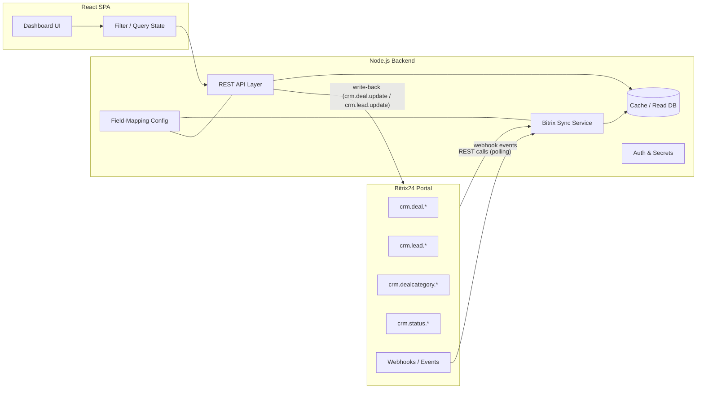

# Software Requirements Specification
## Nural CRM Performance Dashboard — React + Node.js, Bitrix24-Integrated

| | |
|---|---|
| **Document version** | 1.1 |
| **Date** | 21 Oct 2026 (revised) |
| **Status** | Draft — for engineering review. 3 of 5 Phase 0 open items resolved by stakeholder decision; 2 remain pending live-portal confirmation (§6.5). |
| **Reference prototype** | `nural_crm_dashboard.html` (static HTML/Chart.js prototype, Nural brand system applied) |
| **Target stack** | React 18+ (frontend), Node.js 20+ (backend API), Bitrix24 REST API (data source) |

---

## 1. Introduction

### 1.1 Purpose
This document specifies the requirements for rebuilding the Nural CRM Performance Dashboard as a production web application with a React frontend and a Node.js backend, replacing the current static HTML prototype and sitting on top of live Bitrix24 CRM data instead of sample/mock data.

The prototype (`nural_crm_dashboard.html`) is the authoritative **visual and interaction reference** — every panel, filter, and modal specified below corresponds directly to something already built and working in that file. This SRS turns that prototype into an implementable system: it adds the missing backend, defines exactly which Bitrix24 field feeds which pixel, and specifies the read (inbound) and write (outbound) data contracts needed to make every number real instead of sample data.

### 1.2 Scope
In scope:
- A React single-page application reproducing and extending the dashboard's 9 panels (KPI row, Lead Funnel, Deal Stage Funnel, Lead Source Performance, Pipeline Breakdown, Won vs Lost Trend, Deals at Risk, Missing Value action list, filter bar with Period/Pipeline/Custom-date-range)
- A Node.js backend that authenticates to Bitrix24, reads CRM data, computes derived metrics, caches results, and exposes a clean REST API to the frontend
- Outbound write-back from the dashboard into Bitrix24 (the "Missing Value" modal's pipeline-tagging and potential-value actions)
- A full data dictionary mapping every dashboard data point to its Bitrix24 field(s), direction (inbound/outbound), and derivation logic

Out of scope (for v1):
- Editing CRM records beyond the two specific Missing Value actions (pipeline tag, potential value)
- A native mobile app (responsive web only)
- Lead/Deal creation workflows
- Bitrix24 telephony, email, or marketing-automation modules

### 1.3 Intended audience
Engineering (frontend/backend), QA, and the Nuraltech business stakeholder(s) who will approve field mappings against the live Bitrix24 portal before build starts.

### 1.4 Definitions & abbreviations
| Term | Meaning |
|---|---|
| SRS | This document |
| Inbound data point | A value the dashboard reads **from** Bitrix24 |
| Outbound data point | A value the dashboard writes **to** Bitrix24 |
| Flagship pipeline | One of the four top-level buckets: Nural Sales, Nural Service, Nural Assets, Nural Custom |
| Variant | A sub-pipeline nested under the Nural Sales flagship (DMS, DMS+SFA, DMS+SFA+ISP, Schemes, …) |
| Semantic stage | Bitrix24's P (in process) / S (won) / F (lost) classification of a deal stage |
| L | Lakh (₹100,000) — the currency display unit used throughout the dashboard |

---

## 2. System Overview

### 2.1 Architecture

- **Bitrix24** remains the single source of truth for all CRM records.
- **Node.js backend** owns all Bitrix24 credentials and API calls — the React frontend never talks to Bitrix24 directly. It polls/syncs on a schedule (and optionally via Bitrix24 event webhooks for near-real-time updates), computes every derived metric in this SRS's data dictionary, caches the results, and serves a small, dashboard-shaped REST API.
- **React frontend** is a pure consumer of the backend's API. It owns filter state (Period, Pipeline, Custom date range) and re-queries the backend when filters change, exactly matching the client-side interactivity already built in the HTML prototype (`selectPipeline`, `selectPeriod`, `applyCustomRange`).

### 2.2 Why not call Bitrix24 directly from the browser
The current HTML prototype simulates filtering with in-memory sample data. A production build must not expose Bitrix24 webhook/OAuth credentials to the browser, must respect Bitrix24 REST rate limits (2 requests/second per the standard REST limit, batched via `batch` where possible), and must be able to cache/aggregate across potentially thousands of records — none of which belongs in client-side JavaScript. Hence the Node.js layer is mandatory, not optional.

---

## 3. User Roles

| Role | Access |
|---|---|
| **Sales/Ops viewer** | Read-only dashboard access: all panels, all filters |
| **Pipeline admin** | Viewer access + can action the Missing Value modal (write pipeline tag + potential value back to Bitrix24) |
| **System/service account** | The Bitrix24 webhook or OAuth app identity the Node backend authenticates as — not a dashboard user; scoped to `crm` read + the specific write methods needed |

Role enforcement is out of scope for Bitrix24 itself (Bitrix24 permissions govern what the service account can see) but **is** in scope for the dashboard app: the frontend/backend must gate the Missing Value "Update" action behind the Pipeline admin role.

---

## 4. Functional Requirements

Each requirement below maps directly to a panel already built in `nural_crm_dashboard.html`. IDs are stable for traceability into test cases and tickets.

### FR-1 — Filter Bar
- FR-1.1: Period filter with three states: **This Quarter**, **This Month**, **Custom**. Selecting Custom opens a date-range picker (From/To calendar inputs) matching the existing modal; applying a range re-queries every panel for that exact range — no proportional scaling approximation (the prototype's `factor = days/90` scaling was a sample-data stand-in; production must filter real records by actual date).
- FR-1.2: Pipeline filter with five states: **All**, **Nural Sales**, **Nural Service**, **Nural Assets**, **Nural Custom**. Selecting one re-scopes the KPI row and the Pipeline Breakdown table to that flagship bucket. Per the existing design, it does **not** re-scope the two funnel panels (Lead Funnel, Deal Stage Funnel) or Lead Source Performance — those remain combined-pipeline views, consistent with the prototype's documented behavior.
- FR-1.3: The filter-status line (`Showing: <pipeline> · <period>`) must always reflect the active combination.
- FR-1.4: Changing any filter must not require a full page reload — all affected panels re-fetch via the backend API.

### FR-2 — KPI Row (9 tiles)
Open Deals, Open Pipeline Value, Weighted Forecast, Win Rate, Avg Deal Size, Deals at Risk, New Leads (period), Total Leads, Missing Value. Exact computation per tile is specified in the Data Dictionary (§6). The Missing Value tile is clickable and opens FR-7.

### FR-3 — Lead Funnel ("Current CRM Stages")
- Forward funnel, in order: **In Progress → Hot → Warm → Converted to Deal**.
- Disqualified/nurture group, shown separately below a divider: **Cold**, **Lost**.
- **Unassigned** and **Junk Lead** statuses are excluded entirely from this panel's denominator and counts.
- Each stage shows an absolute count and that stage's % share of the total displayed (qualified) leads — explicitly *not* a stage-to-stage conversion rate, matching the prototype's own footnote.
- Panel badge shows the total relevant lead count (sum of all displayed stages).

### FR-4 — Deal Stage Funnel
- Stages, in order: **Proposal/Quote → Revised Proposal → Negotiation → Purchase Order → Closed Won**, with **Closed Lost** shown as the terminal negative outcome.
- Combined across all pipelines/categories (not scoped by the Pipeline filter — see FR-1.2).
- Stage-to-stage conversion % shown per stage.

### FR-5 — Lead Source Performance
- Shows the **Top 6** lead sources by lead volume, each with Leads, Converted to Deal, and Conversion %.
- The source list **must be computed dynamically** from live Bitrix24 source data on every refresh — never a hardcoded list — so the panel keeps working unmodified if sources are added, renamed, or retired in Bitrix24.
- Business rule (confirmed, carry over from prototype): any lead whose source is exactly **"Call"** is merged into **"Website Enquiry"** together with leads sourced as **"Website"**. This normalization happens server-side before ranking.
- **"Existing Client"** is excluded from this panel — it is an acquisition-source performance view, not a full source census.
- Sources with zero leads in the active filter scope are dropped before ranking (never shown padded with empty rows).

### FR-6 — Pipeline Breakdown Table
- Rows grouped by **flagship pipeline** (Nural Sales, Nural Service, Nural Assets, Nural Custom), each a bold rollup row with Open Deals / Open Value / Lost Value / Stage Mix.
- **Nural Sales** additionally expands into nested **variant** rows (Nural Sales – DMS, DMS+SFA, DMS+SFA+ISP, Schemes, and any future Sales variant) — nesting must be driven by a naming convention/config, not a hardcoded variant list, so a newly created Sales variant pipeline in Bitrix24 appears automatically.
- **Nural Custom** is the catch-all: any deal/lead not matching Sales, Service, or Assets lands here automatically — including bespoke/custom-development engagements — so nothing is silently excluded from reporting.
- A totals row sums all flagship buckets; hidden when a single pipeline filter is active (the flagship row itself serves as the subtotal in that case), matching current prototype behavior.
- No internal scrolling — the full breakdown, however many variants, renders on one screen (this was the specific failure the prototype's redesign set out to fix in the original Bitrix24 BI Builder dashboard).

### FR-7 — Missing Value: KPI tile + action list
- The "Missing Value" KPI tile shows the count of deals **and** leads with no potential value pegged (`OPPORTUNITY` null or 0), split out in the subtext as "N deals · M leads".
- Clicking the tile opens a modal list view of every flagged record (not paginated away — this is explicitly an actionable worklist, not a report).
- Each row shows: record type (Deal/Lead), name, current pipeline tag (or "untagged"), an **editable pipeline-assignment dropdown**, an **editable potential-value input**, and an **Update** action.
- "Update" is an outbound write: it must call the backend, which calls Bitrix24 (`crm.deal.update` / `crm.lead.update`) to set the chosen pipeline and/or value on the real record, then remove that row from the list view and decrement the KPI tile on success.
- A failed write must show an inline error on that row and must **not** silently remove the row (no optimistic-success-on-failure).
- This action is gated to the **Pipeline admin** role (§3).

### FR-8 — Won vs Lost Trend
- Bar chart, Won vs Lost deal counts by month, 6-month window by default, reshaping to the active Period filter's window (This Month = latest bar only, This Quarter = last 3 months, Custom = the exact selected range bucketed by month).

### FR-9 — Deals at Risk
- Lists open deals with no stage movement for more than a configurable threshold (default 14 days), each row showing deal name, value, current stage, days in stage, and owner.
- Severity tag: **High** above a second configurable threshold (default 21 days), **Watch** otherwise.
- "Populate automatically" — this panel has no manual-entry fallback; if the underlying Bitrix24 field needed to compute days-in-stage is unavailable (see §6 open item), this panel must degrade to an explicit "not available" state rather than show stale/wrong data.

### FR-10 — Branding & responsive layout
- Must continue to use the Nural brand system already applied in the prototype (Manrope/Work Sans typefaces, the documented Primary/Secondary color tokens, pill buttons, flat fills, no gradients) — see the Nural brand design system as the authority for any new UI not already covered by the prototype.
- Responsive down to the breakpoints already defined in the prototype's CSS (1100px: KPI row to 3 columns, two-column rows stack; 700px: funnel labels narrow).

---

## 5. External Interface Requirements — Bitrix24 REST API

### 5.1 Authentication
Two supported options — pick one during Phase 0 (§10):
1. **Inbound webhook** (simplest): a portal-admin-generated webhook URL with a fixed access token, scoped to `crm`. Fast to stand up, but the token is long-lived and portal-wide — must be stored as a backend secret (never in frontend code or version control) and rotated per the organization's secret-rotation policy.
2. **Local/OAuth2 application**: registered in the Bitrix24 portal, issuing short-lived access tokens refreshed via a refresh token. More setup, but standard OAuth2 lifecycle and finer-grained scopes. Preferred if the dashboard will eventually need write access beyond the two Missing Value fields, or if the portal's security policy requires token rotation.

Either way: **all Bitrix24 credentials live only in the Node.js backend.** The React frontend never holds a Bitrix24 token.

### 5.2 Core methods used

| Method | Purpose | Direction |
|---|---|---|
| `crm.deal.list` | Bulk read deals with filter/select | Inbound |
| `crm.deal.fields` | Discover available deal fields (including any custom `UF_CRM_*` fields) — **run this during Phase 0 against the live portal before finalizing field names below** | Inbound (discovery) |
| `crm.deal.get` | Single-record read (not typically needed if `.list` covers it) | Inbound |
| `crm.deal.update` | Write pipeline tag + potential value (Missing Value action) | Outbound |
| `crm.lead.list` | Bulk read leads with filter/select | Inbound |
| `crm.lead.fields` | Discover available lead fields | Inbound (discovery) |
| `crm.lead.update` | Write pipeline tag + potential value (Missing Value action) | Outbound |
| `crm.dealcategory.list` | List all pipelines/categories (needed to resolve `CATEGORY_ID` → pipeline name) | Inbound |
| `crm.dealcategory.stage.list` | List stages per category, including `SEMANTICS` (P/S/F) and `NAME` | Inbound |
| `crm.status.list` (`ENTITY_ID=STATUS`) | Lead status master list (`STATUS_ID` → display name) | Inbound |
| `crm.status.list` (`ENTITY_ID=SOURCE`) | Lead/deal source master list (`SOURCE_ID` → display name) — this is what makes Lead Source Performance's "Top 6" dynamic per FR-5 | Inbound |
| `batch` | Combine multiple of the above into one round trip to respect rate limits | Inbound |

### 5.3 Rate limits & batching
Bitrix24 REST enforces a request-rate limit (standard portals: ~2 requests/second, burst-tolerant up to a queue limit before `QUERY_LIMIT_EXCEEDED`). The Node backend must:
- Use `start`/pagination correctly on `.list` calls (max 50 rows per page by default) rather than looping naively.
- Batch independent calls via Bitrix24's `batch` method where the panel needs multiple lookups (e.g., deals + categories + stages in one round trip).
- Back off and retry on `429`/`QUERY_LIMIT_EXCEEDED` with exponential backoff, never a tight retry loop.
- Never call Bitrix24 directly on every dashboard page load — always serve from the backend's cache (§8) and refresh on a schedule.

---

## 6. Data Dictionary — every dashboard data point, inbound and outbound

This is the core deliverable: every number or label on the dashboard, where it comes from, and what Bitrix24 field(s) it is computed from.

**Notation:** fields marked `(derived)` are not a literal Bitrix24 field — they are computed server-side in the Node backend from one or more raw fields, per the derivation column. Fields marked **CONFIRM** must be checked against the live portal's `crm.deal.fields` / `crm.lead.fields` / `crm.status.list` output during Phase 0, since custom field codes (`UF_CRM_*`) and custom status codes are portal-specific and cannot be assumed from this prototype alone.

### 6.1 Deals — inbound

| Dashboard element | Bitrix24 field(s) | Entity/Method | Derivation |
|---|---|---|---|
| Open Deals (KPI) | `STAGE_ID` → `SEMANTICS` | `crm.deal.list` + `crm.dealcategory.stage.list` | `COUNT(*)` where derived semantic = `P` |
| Open Pipeline Value (KPI) | `OPPORTUNITY` | `crm.deal.list` | `SUM(OPPORTUNITY)` where semantic = `P` |
| Weighted Forecast (KPI) | `OPPORTUNITY` + stage probability **(derived — static config, decided, see §6.5 item 1)** | `crm.deal.list` | `SUM(OPPORTUNITY × stage_probability)`, where `stage_probability` is looked up from a backend-maintained config table keyed by `STAGE_ID` (not a Bitrix field) |
| Win Rate (KPI) | `STAGE_ID` → `SEMANTICS`, `CLOSEDATE` | `crm.deal.list` | `won / (won + lost)` within period |
| Avg Deal Size (KPI) | `OPPORTUNITY` | `crm.deal.list` | `SUM(OPPORTUNITY) / COUNT(deals where OPPORTUNITY > 0)` |
| Deals at Risk (KPI + panel) | `MOVED_TIME` **(confirmed present & populated — §6.5 item 2)**, `STAGE_ID` | `crm.deal.list` | `COUNT`/list where semantic = `P` and `NOW() − MOVED_TIME > threshold_days`. No custom stage-history log needed — `MOVED_TIME` is used directly as the stage-entry timestamp |
| Deal Stage Funnel | `STAGE_ID`, `CATEGORY_ID` | `crm.deal.list` + `crm.dealcategory.stage.list` | Group by canonical stage bucket (derived mapping, since each category has its own `STAGE_ID` codes) |
| Pipeline Breakdown rows | `CATEGORY_ID` → category `NAME` **(confirmed convention — §6.5 item 3)** | `crm.deal.list` + `crm.dealcategory.list` | `pipeline_family` + `pipeline_variant` parsed from the deal category's `NAME` field (e.g. category literally named "Nural Sales - DMS"); a category name starting with "Nural Sales" rolls up to the Nural Sales flagship automatically |
| Won vs Lost Trend | `STAGE_ID` → `SEMANTICS`, `CLOSEDATE` | `crm.deal.list` | Monthly `COUNT` grouped by semantic S/F |
| Missing Value — deals | `OPPORTUNITY`, `CATEGORY_ID`, `TITLE` | `crm.deal.list` | `OPPORTUNITY IS NULL OR OPPORTUNITY = 0` |
| Deals at Risk — Owner | `ASSIGNED_BY_ID` → resolved name | `crm.deal.list` + `user.get` | Join to display name instead of raw user ID |

### 6.2 Deals — outbound (Missing Value action, FR-7)

| Dashboard action | Bitrix24 field(s) written | Method |
|---|---|---|
| Assign/change pipeline | `CATEGORY_ID` (and `STAGE_ID` if Bitrix requires a valid stage for the target category — **CONFIRM**: changing `CATEGORY_ID` without a compatible `STAGE_ID` may be rejected by Bitrix24) | `crm.deal.update` |
| Set potential value | `OPPORTUNITY` (and `CURRENCY_ID` if not already set on the record) | `crm.deal.update` |

### 6.3 Leads — inbound

| Dashboard element | Bitrix24 field(s) | Entity/Method | Derivation |
|---|---|---|---|
| New Leads (period) (KPI) | `DATE_CREATE` | `crm.lead.list` | `COUNT` where `DATE_CREATE` within active period |
| Total Leads (KPI) | `STATUS_ID` | `crm.lead.list` | `COUNT` where `STATUS_ID != CONVERTED` |
| Lead Funnel stages | `STATUS_ID` | `crm.lead.list` + `crm.status.list (ENTITY_ID=STATUS)` | Forward/disqualified/excluded bucket per status, via a maintained config map (lead statuses carry no built-in semantic grouping the way deal stages do — **CONFIRM** exact `STATUS_ID` codes for In Progress/Hot/Warm/Cold against the live portal; these are evidently custom statuses, not Bitrix defaults) |
| Lead Source Performance | `SOURCE_ID`, `STATUS_ID` | `crm.lead.list` + `crm.status.list (ENTITY_ID=SOURCE)` | Group by normalized source name; conversion = `COUNT(STATUS_ID = CONVERTED) / COUNT(*)` per source |
| Missing Value — leads | `OPPORTUNITY` (or portal's equivalent potential-value field — **CONFIRM**: standard leads do carry `OPPORTUNITY`, but verify it's actually populated/used on this portal rather than a custom field) | `crm.lead.list` | `OPPORTUNITY IS NULL OR OPPORTUNITY = 0` |

### 6.4 Leads — outbound (Missing Value action, FR-7)

| Dashboard action | Bitrix24 field(s) written | Method |
|---|---|---|
| Assign/change pipeline tag | A field TBD — **CONFIRM**: leads don't have `CATEGORY_ID` the way deals do unless the portal uses multi-pipeline leads; most likely this is a custom `UF_CRM_*` field or is implemented as "convert lead into a deal in the target category" rather than a simple field write (see Open Item 4) | `crm.lead.update` (or `crm.lead.convert` workflow) |
| Set potential value | `OPPORTUNITY` (and `CURRENCY_ID`) | `crm.lead.update` |

### 6.5 Open items — status as of v1.1

Three of the five original open items are now decided (by stakeholder input); two remain pending live-portal confirmation in Phase 0.

**✅ Resolved**

1. **Weighted Forecast / stage probability — DECIDED: static config table.** Standard Bitrix24 REST does not expose a numeric win-probability field on deal stages, and this portal has no custom field for it either. The backend will maintain its own admin-configurable probability-per-stage table (keyed by `STAGE_ID`, editable without a code change), rather than reading a Bitrix field. Phase 0 still needs to populate sensible starting percentages per stage with the business.
2. **`MOVED_TIME` / `MOVED_BY_ID` — DECIDED: confirmed present.** These Bitrix24 deal fields are confirmed present and populated on this portal. Deals at Risk uses `MOVED_TIME` directly as the stage-entry timestamp (`days_in_stage = NOW() − MOVED_TIME`) — **no** custom stage-history log needs to be built, simplifying Phase 2 considerably versus the fallback approach originally flagged.
3. **Pipeline family/variant naming convention — DECIDED: deal `CATEGORY_ID` → `NAME`.** The flagship/variant split is driven by the Bitrix24 deal category's `NAME` field (e.g. a category literally named "Nural Sales - DMS"), not by a product field. `pipeline_family` is parsed via a `NAME LIKE 'Nural Sales%'`-style rule (any category whose name starts with "Nural Sales" rolls up to the Nural Sales flagship automatically); `pipeline_variant` keeps the raw category name for the nested row. Phase 0 still needs to pull the live `crm.dealcategory.list` output once to confirm the exact category names match this convention (no unexpected naming gaps).

**⏳ Still open — confirm during Phase 0**

4. **Lead pipeline-tagging mechanism.** Deals have a native `CATEGORY_ID` to represent pipeline; leads in base Bitrix24 CRM typically do not. Still undecided whether "tagging a lead's pipeline" in the Missing Value modal should: (a) write to a custom lead field, or (b) trigger a lead→deal conversion into the chosen pipeline (via `crm.lead.convert`). This materially changes the outbound integration for that one action — **Phase 6 (outbound write-back) cannot be fully scoped until this is settled.**
5. **Lead status → funnel bucket mapping.** The exact `STATUS_ID` codes behind "In Progress / Hot / Warm / Cold / Converted to Deal" (and which ones count as "Unassigned"/"Junk Lead" for exclusion) still need to be pulled from this portal's live `crm.status.list` — custom statuses get portal-generated codes that cannot be guessed from display labels alone. **Blocks Phase 2's lead-funnel bucketing config.**

Items 4 and 5 should be resolved with a Nuraltech stakeholder who has Bitrix24 admin access, early in Phase 0 (§10), since Phase 2 (data layer) and Phase 6 (outbound write-back) depend directly on them.

---

## 7. Non-Functional Requirements

| Category | Requirement |
|---|---|
| **Performance** | Dashboard initial load ≤ 2s from cached backend data (not a live Bitrix24 round trip per page view); filter changes ≤ 1s to re-render from cache |
| **Freshness** | Backend sync cadence configurable; default every 5–15 minutes via scheduled poll, supplemented by Bitrix24 event webhooks (`ONCRMDEALUPDATE`, `ONCRMLEADUPDATE`, etc.) for near-real-time updates on the records that matter most (Missing Value list, Deals at Risk) |
| **Availability** | Dashboard must degrade gracefully (serve last-known-good cached data with a visible "data as of …" timestamp) if Bitrix24 is temporarily unreachable, rather than showing a blank/broken screen |
| **Security** | Bitrix24 credentials never leave the backend; all dashboard↔backend traffic over HTTPS; outbound write actions (FR-7) require the Pipeline admin role and are logged with who/what/when |
| **Auditability** | Every outbound write (Missing Value Update) is logged: user, record ID, old value, new value, timestamp — for traceability back into Bitrix24 if a value needs to be reverted |
| **Accessibility** | Meet WCAG AA contrast minimums (the existing Nural brand palette is built to this standard); keyboard-navigable filters and modals |
| **Browser support** | Latest two versions of Chrome, Edge, Firefox, Safari; responsive to the breakpoints already defined in the prototype |
| **Currency/locale** | All monetary values displayed in ₹ Lakhs (`fmtLakh`-style formatting, matching the prototype), India-locale date formatting |
| **Scalability** | Backend data layer must handle portals with tens of thousands of deals/leads without the dashboard degrading — aggregate server-side, never ship raw record lists to the frontend for client-side crunching |

---

## 8. Backend API Design (Node.js → React contract)

Proposed REST surface (JSON), all parameterized by `period` (`quarter` \| `month` \| `from`/`to`) and `pipeline` (`all` \| `sales` \| `service` \| `assets` \| `custom`) query params where applicable:

| Endpoint | Method | Maps to |
|---|---|---|
| `/api/dashboard/kpis` | GET | FR-2 — all 9 KPI tiles in one payload |
| `/api/dashboard/lead-funnel` | GET | FR-3 |
| `/api/dashboard/deal-funnel` | GET | FR-4 |
| `/api/dashboard/lead-sources` | GET | FR-5 |
| `/api/dashboard/pipeline-breakdown` | GET | FR-6 |
| `/api/dashboard/trend` | GET | FR-8 |
| `/api/dashboard/deals-at-risk` | GET | FR-9 |
| `/api/dashboard/missing-value` | GET | FR-7 — the actionable list |
| `/api/deals/:id` | PATCH | FR-7 outbound — pipeline + value write |
| `/api/leads/:id` | PATCH | FR-7 outbound — pipeline + value write |
| `/api/meta/pipelines` | GET | Resolved flagship/variant list, for the filter bar and the Assign-Pipeline dropdowns — must come from live Bitrix24 categories, never hardcoded, per FR-5/FR-6's dynamic-list requirement |
| `/api/meta/last-sync` | GET | Powers the "data as of …" freshness indicator (§7 Availability) |

A single combined `/api/dashboard` endpoint returning everything in one payload is also reasonable for v1 to minimize round trips, splitting into the table above only if individual panels need independent refresh cadences later.

---

## 9. Error Handling

- **Bitrix24 unreachable during sync:** serve cached data, surface a non-blocking "last updated" banner; log the failure; retry on next scheduled cycle.
- **Bitrix24 rate limit hit:** queue and back off (§5.3); never drop the sync silently.
- **Outbound write fails (Missing Value Update):** row stays in the list, inline error shown, no optimistic UI change (FR-7).
- **Unmapped/unexpected `STAGE_ID` or `STATUS_ID`** (e.g., a brand-new pipeline or status created in Bitrix24 that isn't yet in the field-mapping config): must not crash the panel — fall into a visible "Unmapped" bucket rather than being silently dropped from totals, so data integrity issues surface instead of hiding.

---

## 10. Implementation Roadmap

Suggested phased delivery. Each phase produces something demonstrable rather than a long heads-down build.

### Phase 0 — Discovery & Bitrix24 field confirmation (prerequisite, blocks Phase 2)
- Register the Bitrix24 integration (webhook or local OAuth app per §5.1).
- Pull live `crm.deal.fields`, `crm.lead.fields`, `crm.dealcategory.list`, `crm.dealcategory.stage.list`, `crm.status.list` (STATUS + SOURCE) against the real portal.
- 3 of 5 field-mapping decisions are already made (§6.5, items 1–3: stage-probability config, `MOVED_TIME` usage, category-name-based pipeline parsing) — Phase 0 just needs to validate them against the live `crm.dealcategory.list`/`crm.deal.fields` output.
- Resolve the 2 remaining open items (§6.5, items 4–5: lead pipeline-tagging mechanism, lead-status-code mapping) with the Nuraltech business stakeholder — this phase's output is a finalized, portal-specific field-mapping config, not code.
- **Deliverable:** a confirmed field-mapping document (this SRS's §6 tables, filled in with real codes instead of "CONFIRM" placeholders).

### Phase 1 — Backend foundation
- Node.js project scaffold, Bitrix24 REST client wrapper (auth, batching, rate-limit backoff per §5.3).
- Secrets management for Bitrix24 credentials (never committed, environment-based).
- Basic health-check and `/api/meta/last-sync` endpoints.
- **Deliverable:** backend can authenticate to Bitrix24 and pull a raw deal/lead list successfully.

### Phase 2 — Data layer & derived metrics
- Implement the field-mapping config from Phase 0 as code (stage-semantic resolution, lead-status bucketing, pipeline flagship/variant parsing, lead-source normalization).
- Implement each KPI/panel computation from §6 against live data.
- Implement the sync/cache layer (scheduled poll + optional webhook listeners).
- **Deliverable:** every number in §6's inbound tables can be computed correctly from a backend script/test, before any API or UI exists.

### Phase 3 — Backend API
- Build the endpoint surface from §8 on top of Phase 2's data layer.
- **Deliverable:** Postman/curl-testable API returning real dashboard data as JSON.

### Phase 4 — React frontend scaffold
- Component library matching the Nural brand tokens already defined in the prototype's CSS (colors, type scale, pill buttons, card/panel shell).
- Build each of the 9 panels as components, initially against mocked/static data matching the prototype's exact layout and interactions (filter chips, funnels, breakdown table, modals).
- **Deliverable:** pixel-equivalent recreation of `nural_crm_dashboard.html` in React, still on sample data.

### Phase 5 — Frontend ↔ backend integration
- Wire each component to its Phase 3 endpoint; replace sample data with live API calls.
- Reproduce filter-state behavior exactly (Pipeline chips scoping KPI row + breakdown table only; Period/Custom date range re-querying real data, replacing the prototype's proportional-scaling approximation with true date-filtered queries).
- **Deliverable:** fully live dashboard, read-only.

### Phase 6 — Outbound write-back
- Implement the Missing Value modal's Update action end-to-end: frontend form → `PATCH /api/deals/:id` or `/api/leads/:id` → Bitrix24 write → cache invalidation → row removal/KPI decrement on success.
- Implement the audit log (§7 Auditability) and the Pipeline admin role gate (§3, FR-7).
- **Deliverable:** the one write-capable interaction in the system, fully tested including failure paths.

### Phase 7 — Testing
- Unit tests for every derivation function in §6 (stage-semantic mapping, pipeline parsing, lead-source normalization, days-at-risk calculation).
- Integration tests against a Bitrix24 sandbox/staging portal.
- E2E tests (e.g., Playwright/Cypress) covering: filter interactions, modal open/close, Missing Value update success and failure paths.

### Phase 8 — Non-functional hardening
- Load-test the sync layer against realistic record volumes (§7 Scalability).
- Confirm graceful-degradation behavior when Bitrix24 is unreachable (§9).
- Accessibility pass against WCAG AA.

### Phase 9 — Deployment & monitoring
- CI/CD pipeline, environment separation (dev/staging/prod), secrets per environment.
- Basic monitoring/alerting on sync failures and Bitrix24 rate-limit events.

### Phase 10 — UAT & go-live
- Walk the Nuraltech stakeholder through the live dashboard against the original prototype, panel by panel, confirming every number matches expectations against known Bitrix24 records.
- Cut over, retire the BI Builder dashboard / static prototype as the primary reference.

---

## 11. Assumptions & Dependencies

- The Bitrix24 portal (`b24-qvpbz0.bitrix24.in` or successor) remains the system of record; this dashboard is a read-heavy, narrowly-scoped-write consumer of it, not a replacement.
- Weighted Forecast will use a backend-maintained static probability-per-stage config, not a Bitrix24 field (§6.5 item 1 — decided).
- Deals at Risk will use the Bitrix24 `MOVED_TIME` deal field directly; no custom stage-history tracking is being built (§6.5 item 2 — decided).
- Pipeline flagship/variant grouping is driven by the deal category's `NAME` field, parsed by a "starts with 'Nural Sales'" style convention (§6.5 item 3 — decided).
- A Nuraltech stakeholder with Bitrix24 admin access is still needed during Phase 0 to resolve the 2 remaining open items (§6.5, items 4–5: lead pipeline-tagging mechanism, lead-status-code mapping) — this is now the main schedule risk, since Phase 2 (lead-funnel config) and Phase 6 (outbound write-back for leads) depend on them.
- Standard Bitrix24 REST rate limits apply (no Bitrix24 Enterprise/dedicated-tenant rate-limit exceptions assumed unless confirmed otherwise).
- "Potential value" on leads is assumed to map to the standard `OPPORTUNITY` field pending Phase 0 confirmation (§6.5, item 5 covers status mapping; value-field confirmation is folded into the same discovery pass).

---

## 12. Appendix — Traceability to the reference prototype

| Prototype element (`nural_crm_dashboard.html`) | SRS requirement |
|---|---|
| `.filterbar` (Period/Pipeline chips, Custom range modal) | FR-1 |
| `.kpi-row` (9 tiles, `kpi-*` / `delta-*` ids) | FR-2 |
| Lead Funnel panel (`panel-title: Lead Funnel — Current CRM Stages`) | FR-3 |
| Deal Stage Funnel panel | FR-4 |
| Lead Source Performance panel (`leadSourceChart`, `rawLeadSourceData`, `normalizeLeadSource`) | FR-5 |
| Pipeline Breakdown table (`tr.flagship`, `tr.variant`, `data-pipeline`) | FR-6 |
| Missing Value KPI tile + `#missingValueModal` | FR-7 |
| Won vs Lost Trend (`trendChart`) | FR-8 |
| Deals at Risk panel | FR-9 |
| CSS tokens (`--p500`, `--s500`, etc.), Manrope/Work Sans | FR-10 |
